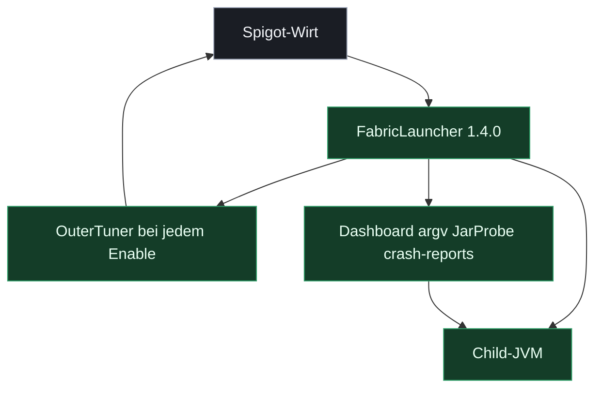

# FabricLauncher

Spigot-Plugin (`de.aichele.childlauncher`), das einen äußeren Spigot-Server als Wirt nutzt: Es startet und überwacht einen Fabric-Child-Server und stellt ein Web-Dashboard bereit. Minimale Spigot-Konfiguration für den äußeren Server liegt unter `spigot-minimal-config/`.

## Server einrichten

Schritt für Schritt auf einem neuen Spigot-Server (nur Spigot beim Hoster, FTP, ein freier Zusatzport für Fabric und einer für das Dashboard): **[docs/SETUP.md](docs/SETUP.md)**.

## Bauen

Voraussetzung: **Java 25** (Minecraft 26.x) und Maven.

```bash
mvn package
```

Das Plugin-Jar liegt danach unter `target/FabricLauncher-1.4.0.jar`.

## Dokumentation

Ausführliche Beschreibung: [docs/Dokumentation.md](docs/Dokumentation.md) (HTML-Fassung: [docs/Dokumentation.html](docs/Dokumentation.html)).

## Feature-Matrix

Diese Linie ist **1.4.0**. Jar `FabricLauncher-1.4.0.jar`. Die Entscheidungsmatrix und alles ab ServerHoster 1.5.0 liegt in [minecraft-serverhoster-plugin](https://github.com/Sciddie/minecraft-serverhoster-plugin).

Grün ist hier live. WorldPorter in diesem Ordner ist außer Dienst. Die Einzelserver-Sperre aus ServerHoster 1.6.0 ist hier noch der ältere `allowParallel`-Stopp beim Start.



| Modul / Bereich | Feature-Name | Status (Live / Idee) | Nutzen / Mehrwert | Ressourcen-Impact (Minimal/Mittel) | Empfehlung (Ja/Nein/Optional) |
|---|---|---|---|---|---|
| Wirt | Spigot plus OuterTuner | Live | Lobby wird bei jedem Enable gedrosselt. | Minimal | Ja |
| Child | Fabric, Paper, Spigot, Vanilla, Custom | Live | Ein Spielprozess. Typ in `config.yml`. | Mittel | Ja |
| Slot | `allowParallel` aus | Live | Start stoppt andere. Ohne die 1.6.0-Sperre. | Minimal | Ja |
| Plan | argv-Vorschau | Live | JVM-Zeile vor dem Start. Kein Download. | Minimal | Ja |
| Jar | JarProbe | Live | Name, Bytes, Pfad. Symlink bleibt zu. | Minimal | Ja |
| Crash | crash-reports lesen | Live | Absturztext. `../` und Symlink weg. | Minimal | Ja |
| Diag | jcmd und tick query | Live | Thread, Heap, Flags, MSPT. | Minimal | Ja |
| Mods | Lithium, Ferrite, Modrinth | Live | Nur diese Defaults. Toggle nach Neustart. | Minimal | Ja |
| Dash | Login, HTTPS, Rohtext, Konsole, Dateien | Live | Admin im Browser. | Mittel | Ja |
| Profile | Fokus, Cron, Backup, Katalog | Live | Profile, Zip, JDBC, Versionsliste. | Mittel | Ja |
| Porter | WorldPorter | Live | Außer Dienst. Nicht erneut installieren. | Minimal | Nein |
| Hoster | Neue Features hier bauen | Idee | Neue Arbeit liegt im ServerHoster-Repo. | Minimal | Nein |

## WorldPorter

Der Unterordner `worldporter/` enthält das frühere Plugin **WorldPorter**. Es hat Spigot-Welten einmalig ins Vanilla-Layout verschoben und ist **außer Dienst**. Nicht erneut installieren.
